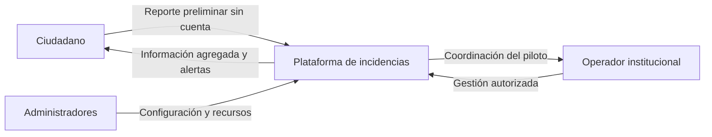
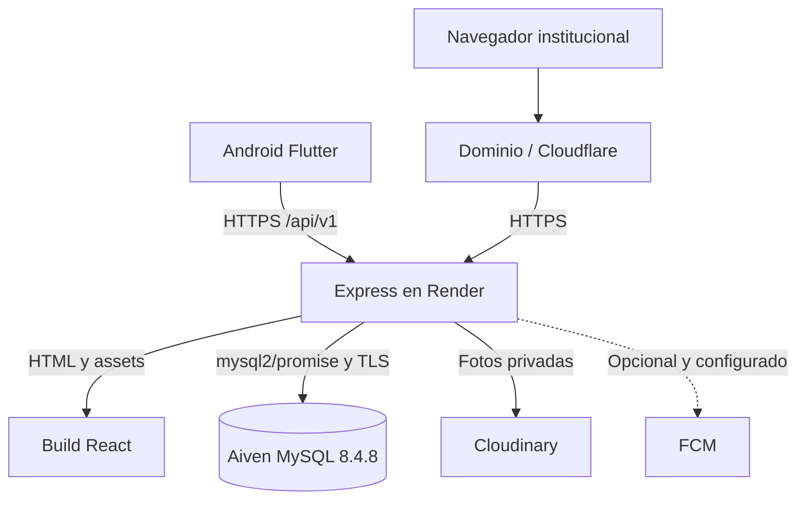
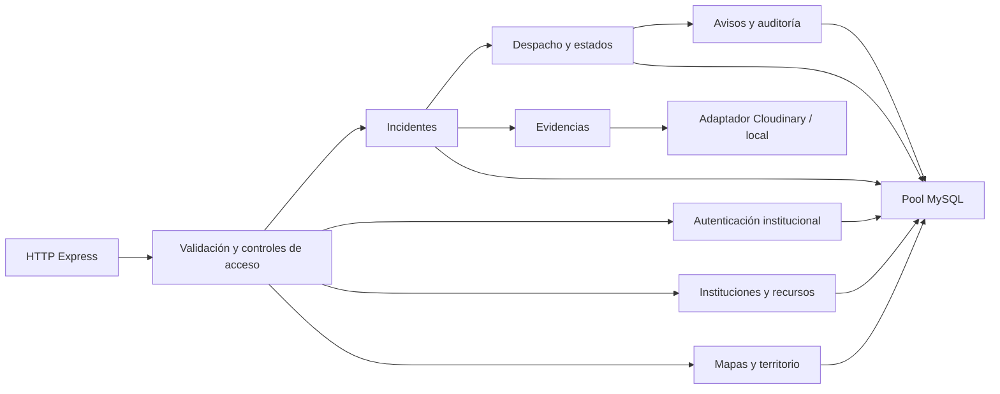
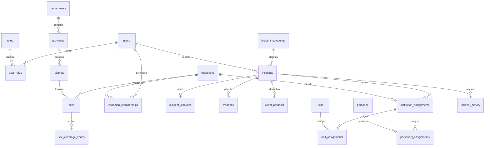
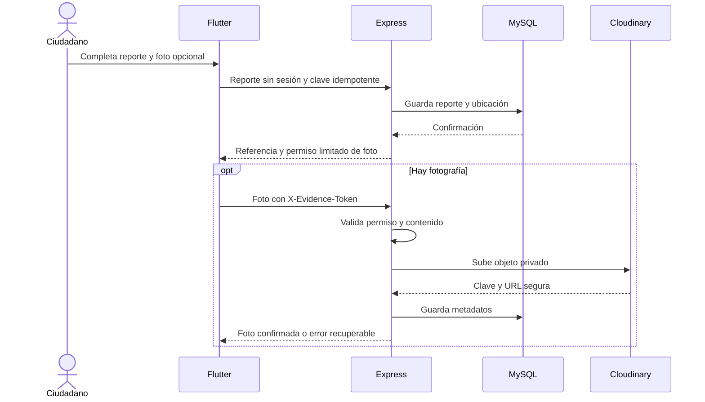

# Descripción del diseño de software (SDD)

## Plataforma de gestión de incidencias

Universidad Nacional de San Cristóbal de Huamanga · Ingeniería de Sistemas · Arquitectura de Software
Versión documental: 1.0 · Fecha: 20 de octubre de 2026
Estado: preparado para revisión académica; diseño contrastado con el código versionado, sin nueva certificación del servicio remoto.

## Contenido

1. Introducción y alcance técnico
2. Arquitectura del sistema
3. Diseño de datos
4. Diseño de componentes e interfaces
5. Diseño de interfaz de usuario
6. Seguridad y decisiones de diseño
7. Despliegue y límites de evolución
8. Referencias y trazabilidad

## 1. Introducción y alcance técnico

Este documento describe cómo se estructura la solución que responde al [SRS](SRS.md). Contiene vistas de arquitectura, modelo de datos, componentes, interfaces y decisiones técnicas. Los requisitos completos, las tareas y los resultados de pruebas tienen documentos separados.

El diseño vigente combina una app Android Flutter, un panel React y una API Node.js/Express organizada como monolito modular. La API es la única que accede a MySQL. El perfil productivo documentado utiliza Render, Aiven MySQL con TLS y Cloudinary para evidencias; el desarrollo conserva Docker Compose y almacenamiento local configurable. El ciudadano no necesita login; el panel institucional sí.

## 2. Arquitectura del sistema

### 2.1 Contexto (C1)



Las instituciones atendidas son PNP, SAMU, Bomberos y Municipalidad/Serenazgo. No hay integración automática acreditada con sus sistemas oficiales.

### 2.2 Contenedores (C2)



React y Express se publican desde el mismo servicio; el build está en `apps/admin/dist`. Las solicitudes privadas no se resuelven en el cliente: Express comprueba identidad y ámbito. Android centraliza el origen de la API en `apps/mobile/lib/core/config.dart`; React en `apps/admin/src/config.js`. Las teselas y la búsqueda geográfica dependen del proveedor configurado; el mapa conserva atribución y no debe descargar teselas masivamente.

### 2.3 Componentes del backend (C3)



Los módulos comparten proceso y base, no son microservicios. Configuración, transporte HTTP y operaciones de dominio tienen archivos separados. El pool se crea centralmente en `src/db/pool.js`; las operaciones sensibles utilizan las verificaciones de autorización del servidor.

## 3. Diseño de datos

### 3.1 Modelo entidad-relación principal



El diagrama es una vista parcial de relaciones físicas; la ubicación se crea junto al reporte en el flujo normal. Los catálogos territoriales y roles usan identificadores numéricos; usuarios, instituciones e incidentes emplean identificadores de texto según las migraciones. El reportante es nullable para admitir invitados. El esquema completo también contiene directorio, alertas, avisos, auditoría, límites de frecuencia y credenciales de sesión.

### 3.2 Inventario del esquema por migración

| Migración versionada | Tablas creadas o alcance |
| --- | --- |
| [001_identity.sql](../../apps/api/migrations/001_identity.sql) | `roles`, `users`, `user_roles`, `refresh_tokens`, `password_reset_tokens` |
| [002_territory_institutions.sql](../../apps/api/migrations/002_territory_institutions.sql) | `departments`, `provinces`, `districts`, `district_boundaries`, `sectors`, `sector_boundaries`, `institutions`, `sites`, `site_coverage_zones`, `institution_memberships` |
| [003_resources_catalogs.sql](../../apps/api/migrations/003_resources_catalogs.sql) | `personnel`, `units`, `incident_categories`, `incident_subcategories`, `routing_rules` |
| [004_incidents.sql](../../apps/api/migrations/004_incidents.sql) | `incidents`, `incident_locations`, `client_requests`, `incident_duplicates` |
| [005_operations_public.sql](../../apps/api/migrations/005_operations_public.sql) | `institution_assignments`, `unit_assignments`, `personnel_assignments`, `incident_history`, `evidence`, `directory_entries`, `alerts`, `notifications`, `audit_logs` |
| [006_rate_limits.sql](../../apps/api/migrations/006_rate_limits.sql) | `rate_limit_counters` |
| [007_unit_status_history.sql](../../apps/api/migrations/007_unit_status_history.sql) | `unit_status_history` |
| [008_category_priority.sql](../../apps/api/migrations/008_category_priority.sql) | Modifica estructura o datos existentes; consultar el SQL. |
| [009_demo_category_priority.sql](../../apps/api/migrations/009_demo_category_priority.sql) | Modifica estructura o datos existentes; consultar el SQL. |
| [010_push_devices.sql](../../apps/api/migrations/010_push_devices.sql) | `push_device_tokens` |
| [011_cloudinary_evidence.sql](../../apps/api/migrations/011_cloudinary_evidence.sql) | Modifica estructura o datos existentes; consultar el SQL. |

La tabla técnica de control se define en [el ejecutor de migraciones](../../apps/api/src/db/migrations.js). El SQL versionado es la referencia física de columnas, índices, claves foráneas y restricciones; esta tabla no es una instrucción para ejecutar cambios. No se ejecutan migraciones al reorganizar la documentación.

### 3.3 Integridad, geografía y evidencias

- InnoDB, claves primarias, claves foráneas, índices únicos y restricciones CHECK expresan integridad. La referencia del incidente es única; la idempotencia se controla por ámbito y clave en `client_requests`.
- Puntos y polígonos usan SRID 4326 e índices espaciales según el SQL. El código y las funciones GIS deben conservar la convención de ejes; no intercambiar latitud/longitud al construir o leer geometrías.
- `incidents.status` distingue `reported, verifying, assigned, en_route, attending, resolved, closed`. La verificación se guarda separadamente en `verification_status`: un duplicado o falso no es otro estado de atención.
- MySQL conserva metadatos de foto: incidente, clave del proveedor (`object_key`), proveedor, URL segura, MIME, tamaño y creación. El binario no se almacena como BLOB. Migración 011 añade proveedor y URL; Cloudinary mantiene los objetos privados.
- La retención final, los respaldos y la recuperación requieren una política operativa aprobada; no se deduce que estén validados por existir el esquema.

## 4. Diseño de componentes e interfaces

### 4.1 Responsabilidades y ubicación

| Componente | Diseño y archivos |
| --- | --- |
| Configuración | `apps/api/src/config/` carga y valida entorno; diferencia modo local/productivo. |
| Acceso | `auth/` resuelve credenciales, JWT, renovación, roles y ámbito. |
| Instituciones/territorio | `institutions/` y `territory/` separan organización, sedes y cobertura. |
| Incidentes | `incidents/` valida reporte, idempotencia, consultas y fotos. |
| Despacho/recursos | `dispatch/` y `resources/` gestionan asignaciones, personal y estados. |
| Información pública | `geospatial/`, `directory/` y `alerts/` limitan la información publicada. |
| Trazabilidad | `audit/` y `notifications/` registran eventos y avisos. |
| Infraestructura | `db/`, `health/`, `lifecycle.js` y `server.js` gestionan conexiones, diagnóstico y ciclo de vida. |

### 4.2 Contrato HTTP y health checks

El contrato normativo de las rutas es [OpenAPI](../../packages/contracts/openapi.yaml). Las operaciones funcionales usan `/api/v1`. `GET /api/health` verifica HTTP y `GET /api/health/database` ejecuta una consulta mínima real; un fallo de base devuelve un error seguro sin convertir la comprobación HTTP en una consulta SQL.

Las rutas públicas incluyen catálogo, reporte invitado, directorio, alertas y mapa de calor según contrato. Las operaciones institucionales, los puntos exactos y la lectura de evidencias requieren autorización. Express sirve HTML y assets desde una ruta calculada con `__dirname`, independiente de `process.cwd()`; el fallback SPA excluye `/api` y archivos inexistentes. HTML usa `no-cache`; JS/CSS con hash bajo assets permiten caché larga. CORS se aplica a la API y no bloquea el servido estático.

### 4.3 Flujo de reporte y fotografía



El permiso de invitado tiene propósito exclusivo de subida, alcance de un incidente y vencimiento de 24 horas desde su creación; no permite lectura. Repetir el reporte idempotente no renueva ese plazo. Flutter conserva el permiso en almacenamiento seguro, separado del comprobante. La API admite JPEG/PNG/WebP hasta 5 MB y tres fotos por reporte; valida contenido y limpia metadatos. El adaptador productivo transmite buffers a Cloudinary; no depende de disco persistente del servidor. Ante fallo, conserva el reporte y permite reintento dentro de los límites. La lectura privada pasa por la API y la autorización, no por publicar enlaces permanentes al ciudadano.

### 4.4 Conectividad, geografía y avisos

Flutter conserva pendientes de envío y reintenta al recuperar conexión o reanudar la app. Esta cola técnica no es un historial privado de incidentes resueltos. La clave idempotente evita nuevas altas por reintentos.

El mapa institucional muestra puntos filtrados por autorización. El público agrega celdas con al menos tres incidentes por categoría; usa 0,2 grados en categorías sensibles y 0,05 en las demás. La consulta limita intervalo y filas. Es una mitigación del piloto, no una garantía de anonimización frente a consultas cruzadas.

Los avisos internos se persisten en MySQL. FCM es opcional y condicionado a configuración; un fallo push no debe deshacer la operación principal. La app actual consulta alertas públicas y no restaura una sesión ciudadana.

## 5. Diseño de interfaz de usuario

### 5.1 Navegación ciudadana

Inicio → Reportar / Mapa / Contactos; el menú añade Alertas y Conoce la app. El reporte se abre sin introducción obligatoria, registro o login. La referencia indica recepción, no denuncia formal ni historial consultable. Los datos de una vista pueden mostrarse durante el uso; los pendientes técnicos conservados para reintento tienen propósito distinto de seguimiento privado.

```text
┌──────────────────────────────┐
│ Incidencias · Sin cuenta     │
│ ¿Qué ocurrió?                │
│ [ Reportar una incidencia ]  │
│ Mapa  ·  Contactos · Alertas │
├──────────────────────────────┤
│ Tipo de reporte              │
│ Descripción                  │
│ Lugar: GPS / buscar / mapa   │
│ Teléfono de contacto opcional│
│ [Añadir foto]  [Enviar]      │
└──────────────────────────────┘
```

Esquema conceptual de jerarquía, no captura de una ejecución nueva. Se usan tema Material 3, verde petróleo, fondos suaves, tarjetas con iconos y etiquetas, foco visible y mensajes de progreso/error. Los colores acompañan texto; los identificadores internos no sustituyen nombres comprensibles. Contactos tiene respaldo nacional cuando falla la API; cualquier llamada exige acción del usuario.

### 5.2 Panel institucional

```text
┌──────────────────────────────────────────────┐
│ Presentación pública → Iniciar sesión       │
├──────────────┬───────────────────────────────┤
│ Dashboard    │ Resumen operativo             │
│ Incidentes   │ Filtros · Bandeja · Detalle    │
│ Mapa         │ Mapa con etiquetas y leyenda   │
│ Recursos (*) │ Asignaciones y personal       │
│ Gestión (*)  │ Instituciones y auditoría     │
└──────────────┴───────────────────────────────┘
```

(*) Visibilidad según rol. El menú refleja permisos; no los concede. La portada se dirige a las entidades, sin tarjetas de llamadas ciudadanas. Los botones tienen estados de foco, hover, pulsación y deshabilitado; las acciones muestran confirmaciones o errores legibles. El detalle autorizado concentra la foto y el contacto opcional; no se publican en mapas abiertos. La [guía de usuarios](../02-guias/USUARIOS.md) explica permisos por perfil.

## 6. Seguridad y decisiones de diseño

| Decisión | Motivo y límite |
| --- | --- |
| Monolito modular | Mantener complejidad abordable para el equipo y separar responsabilidades sin microservicios. |
| Reporte sin login; gestión con login | Reducir pasos ciudadanos sin abrir información privada institucional. |
| Bcrypt, JWT y controles de ámbito | Almacenar hash, validar identidad y filtrar por institución/sede; una sesión no concede acceso global. |
| MySQL con cuenta de aplicación | Usar `incidencias_app`, nunca root ni avnadmin desde la API. |
| TLS verificable a Aiven | Cargar CA desde `DB_CA_PATH` y mantener `rejectUnauthorized: true`. |
| Evidencias privadas externas | Evitar BLOB y dependencia del disco efímero productivo; validar acceso antes de servirlas. |
| CORS acotado | Lista explícita en API, sin bloquear HTML/JS/CSS públicos. |
| Secretos solo en backend | Archivos privados ignorados; plantillas sin valores reales; logs sanitizados. |

El login tiene límites de intentos y los invitados límites propios. Estos controles no garantizan inmunidad frente a ataques. La distribución del sistema requerirá revisar todos los estados y límites compartidos, además de JWT. La política de retención y el uso de datos reales requieren revisión adicional.

## 7. Despliegue y límites de evolución

### 7.1 Perfiles de ejecución

| Perfil | Backend y datos | Evidencias |
| --- | --- | --- |
| Desarrollo | Node.js y MySQL Docker; desde Windows host/puerto configurables (habitualmente 127.0.0.1:3307), `DB_SSL=false`. | Adaptador local configurable. |
| Piloto publicado | Servicio Render que sirve React y API; Aiven MySQL 8.4.8 por TLS, base `incidencias`. | Cloudinary. |
| Pruebas aisladas | Base separada con sufijo de prueba; nunca la base operativa para fixtures. | Dobles o recursos de prueba explícitos. |

Si la API se ejecuta en Docker, el host y puerto internos de MySQL difieren de los publicados en Windows; se resuelve por entorno, no hardcodeando dos conexiones. El entorno local original registró MySQL 9.7.2; las migraciones y la evidencia de compatibilidad Aiven están en [su informe](../03-validacion/MIGRACIONES_AIVEN.md).

### 7.2 Inicio y cierre

El servidor valida entorno, prepara dependencias, carga el CA cuando procede y configura Express antes de escuchar usando el puerto de entorno. Los errores de arranque registran etapa e información segura y terminan con código 1. El pool usa `mysql2/promise`, hasta diez conexiones y cola limitada; el cierre ordenado deja de aceptar solicitudes y cierra el pool. Render puede proporcionar el CA como Secret File; no se versiona su contenido. Procedimientos: [operación Render](../02-guias/OPERACION_RENDER.md).

### 7.3 Evolución pendiente

No se inicia ni se certifica escalamiento horizontal en esta revisión documental. Balanceo, múltiples réplicas, presupuesto de conexiones, límites compartidos, observabilidad y carga requieren un change propio autorizado. No hay evidencia nueva de 1 000–5 000 usuarios. FCM, límites territoriales oficiales, restauración y políticas de retención conservan sus dependencias operativas.

## 8. Referencias y trazabilidad

- [SRS: requisitos y reglas](SRS.md), con identificadores RF/RNF/RN conservados.
- [Plan y verificación](PLAN_Y_VERIFICACION.md): gestión del trabajo y evidencia, fuera del SDD.
- [Contrato OpenAPI](../../packages/contracts/openapi.yaml), [migraciones](../../apps/api/migrations/README.md) y [backend](../../apps/api/README.md): fuentes contrastadas con este diseño.
- [OpenSpec](../../openspec/): specs verificables, diseño por change y tareas de implementación.
- [Antecedente SDD v0.1](../04-historial/SDD_ORIGINAL_v0.1.md) y [evolución móvil](../04-historial/EVOLUCION_MOVIL.md): antecedentes históricos, no instrucciones vigentes.

Este documento no declara conformidad certificada con un estándar externo ni aprobación académica; se organiza como descripción técnica separada de requisitos y tareas.
