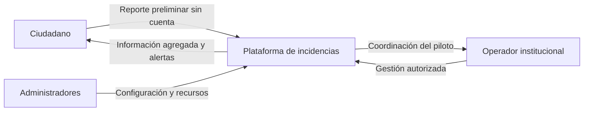
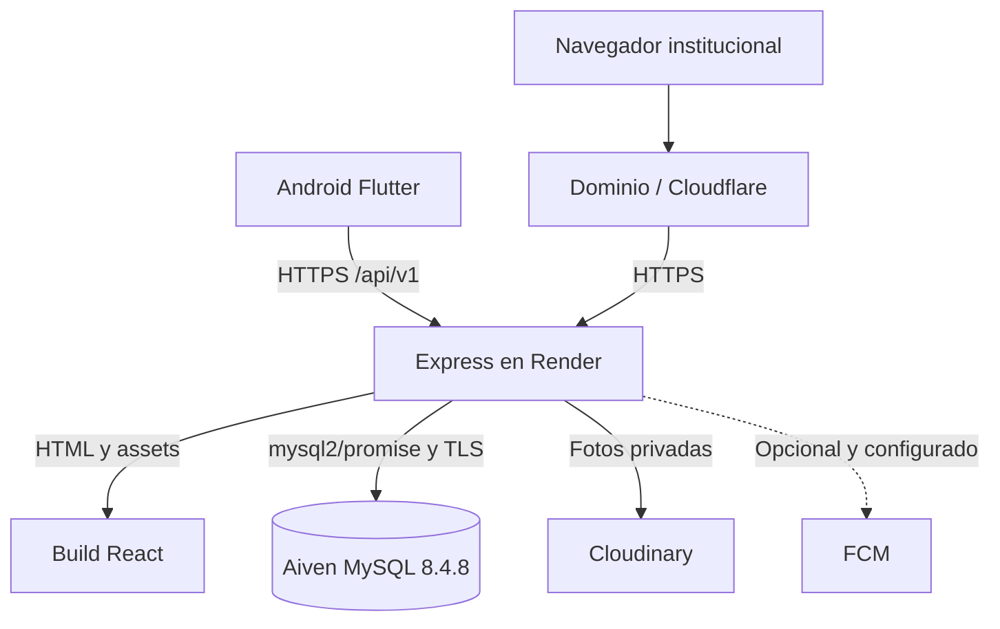
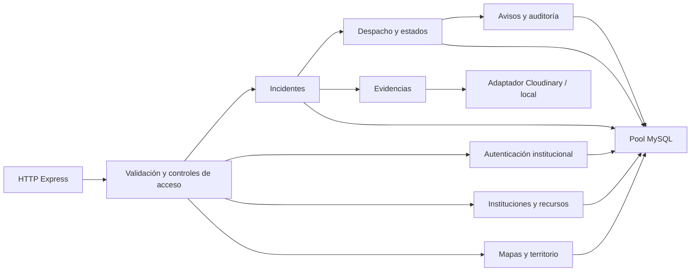
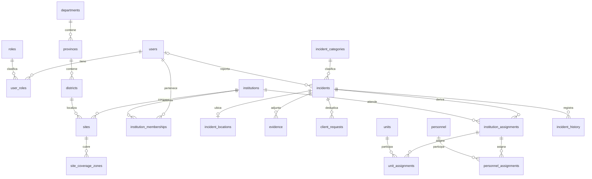
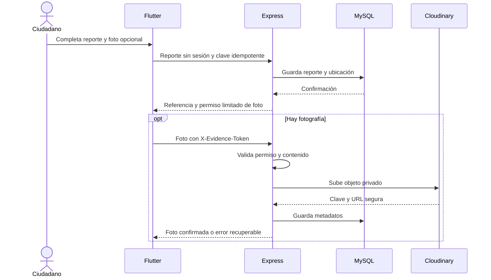

# Descripción del diseño de software (SDD)

## Plataforma de gestión de incidencias

Universidad Nacional de San Cristóbal de Huamanga · Ingeniería de Sistemas · Arquitectura de Software
Versión documental: 1.1 · Actualización: 19 de noviembre de 2026 · Organización inicial: 20 de octubre de 2026
Estado: preparado para revisión académica; diseño contrastado con el código versionado, sin nueva certificación del servicio remoto.

## Contenido

1. Introducción y alcance técnico
2. Arquitectura del sistema
3. Diseño de datos
4. Diseño de componentes e interfaces
5. Diseño de interfaz de usuario
6. Seguridad y decisiones de diseño
7. Despliegue y límites de evolución
8. Referencias y trazabilidad

## 1. Introducción y alcance técnico

Este documento describe cómo se estructura la solución que responde al [SRS](SRS.md). Contiene vistas de arquitectura, modelo de datos, componentes, interfaces y decisiones técnicas. Los requisitos completos, las tareas y los resultados de pruebas tienen documentos separados.

El diseño vigente combina una app Android Flutter, un panel React y una API Node.js/Express organizada como monolito modular. La API es la única que accede a MySQL. El perfil productivo documentado utiliza Render, Aiven MySQL con TLS y Cloudinary para evidencias; el desarrollo conserva Docker Compose y almacenamiento local configurable. El ciudadano no necesita login; el panel institucional sí.

## 2. Arquitectura del sistema

### 2.1 Contexto (C1)



Las instituciones atendidas son PNP, SAMU, Bomberos y Municipalidad/Serenazgo. No hay integración automática acreditada con sus sistemas oficiales.

### 2.2 Contenedores (C2)



React y Express se publican desde el mismo servicio; el build está en `apps/admin/dist`. Las solicitudes privadas no se resuelven en el cliente: Express comprueba identidad y ámbito. Android centraliza el origen de la API en `apps/mobile/lib/core/config.dart`; React en `apps/admin/src/config.js`. Las teselas y la búsqueda geográfica dependen del proveedor configurado; el mapa conserva atribución y no debe descargar teselas masivamente.

### 2.3 Componentes del backend (C3)



Los módulos comparten proceso y base, no son microservicios. Configuración, transporte HTTP y operaciones de dominio tienen archivos separados. El pool se crea centralmente en `src/db/pool.js`; las operaciones sensibles utilizan las verificaciones de autorización del servidor.

## 3. Diseño de datos

### 3.1 Modelo entidad-relación principal



El diagrama es una vista parcial de relaciones físicas; la ubicación se crea junto al reporte en el flujo normal. Los catálogos territoriales y roles usan identificadores numéricos; usuarios, instituciones e incidentes emplean identificadores de texto según las migraciones. El reportante es nullable para admitir invitados. El esquema completo también contiene directorio, alertas, avisos, auditoría, límites de frecuencia y credenciales de sesión.

### 3.2 Inventario del esquema por migración

| Migración versionada | Tablas creadas o alcance |
| --- | --- |
| [001_identity.sql](../../apps/api/migrations/001_identity.sql) | `roles`, `users`, `user_roles`, `refresh_tokens`, `password_reset_tokens` |
| [002_territory_institutions.sql](../../apps/api/migrations/002_territory_institutions.sql) | `departments`, `provinces`, `districts`, `district_boundaries`, `sectors`, `sector_boundaries`, `institutions`, `sites`, `site_coverage_zones`, `institution_memberships` |
| [003_resources_catalogs.sql](../../apps/api/migrations/003_resources_catalogs.sql) | `personnel`, `units`, `incident_categories`, `incident_subcategories`, `routing_rules` |
| [004_incidents.sql](../../apps/api/migrations/004_incidents.sql) | `incidents`, `incident_locations`, `client_requests`, `incident_duplicates` |
| [005_operations_public.sql](../../apps/api/migrations/005_operations_public.sql) | `institution_assignments`, `unit_assignments`, `personnel_assignments`, `incident_history`, `evidence`, `directory_entries`, `alerts`, `notifications`, `audit_logs` |
| [006_rate_limits.sql](../../apps/api/migrations/006_rate_limits.sql) | `rate_limit_counters` |
| [007_unit_status_history.sql](../../apps/api/migrations/007_unit_status_history.sql) | `unit_status_history` |
| [008_category_priority.sql](../../apps/api/migrations/008_category_priority.sql) | Modifica estructura o datos existentes; consultar el SQL. |
| [009_demo_category_priority.sql](../../apps/api/migrations/009_demo_category_priority.sql) | Modifica estructura o datos existentes; consultar el SQL. |
| [010_push_devices.sql](../../apps/api/migrations/010_push_devices.sql) | `push_device_tokens` |
| [011_cloudinary_evidence.sql](../../apps/api/migrations/011_cloudinary_evidence.sql) | Modifica estructura o datos existentes; consultar el SQL. |

La tabla técnica de control se define en [el ejecutor de migraciones](../../apps/api/src/db/migrations.js). El SQL versionado es la referencia física de columnas, índices, claves foráneas y restricciones; esta tabla no es una instrucción para ejecutar cambios. No se ejecutan migraciones al reorganizar la documentación.

### 3.3 Integridad, geografía y evidencias

- InnoDB, claves primarias, claves foráneas, índices únicos y restricciones CHECK expresan integridad. La referencia del incidente es única; la idempotencia se controla por ámbito y clave en `client_requests`.
- Puntos y polígonos usan SRID 4326 e índices espaciales según el SQL. El código y las funciones GIS deben conservar la convención de ejes; no intercambiar latitud/longitud al construir o leer geometrías.
- `incidents.status` distingue `reported, verifying, assigned, en_route, attending, resolved, closed`. La verificación se guarda separadamente en `verification_status`: un duplicado o falso no es otro estado de atención.
- MySQL conserva metadatos de foto: incidente, clave del proveedor (`object_key`), proveedor, URL segura, MIME, tamaño y creación. El binario no se almacena como BLOB. Migración 011 añade proveedor y URL; Cloudinary mantiene los objetos privados.
- La retención final, los respaldos y la recuperación requieren una política operativa aprobada; no se deduce que estén validados por existir el esquema.

## 4. Diseño de componentes e interfaces

### 4.1 Responsabilidades y ubicación

| Componente | Diseño y archivos |
| --- | --- |
| Configuración | `apps/api/src/config/` carga y valida entorno; diferencia modo local/productivo. |
| Acceso | `auth/` resuelve credenciales, JWT, renovación, roles y ámbito. |
| Instituciones/territorio | `institutions/` y `territory/` separan organización, sedes y cobertura. |
| Incidentes | `incidents/` valida reporte, idempotencia, consultas y fotos. |
| Despacho/recursos | `dispatch/` y `resources/` gestionan asignaciones, personal y estados. |
| Información pública | `geospatial/`, `directory/` y `alerts/` limitan la información publicada. |
| Trazabilidad | `audit/` y `notifications/` registran eventos y avisos. |
| Infraestructura | `db/`, `health/`, `lifecycle.js` y `server.js` gestionan conexiones, diagnóstico y ciclo de vida. |

### 4.2 Contrato HTTP y health checks

El contrato normativo de las rutas es [OpenAPI](../../packages/contracts/openapi.yaml). Las operaciones funcionales usan `/api/v1`. `GET /api/health` verifica HTTP y `GET /api/health/database` ejecuta una consulta mínima real; un fallo de base devuelve un error seguro sin convertir la comprobación HTTP en una consulta SQL.

Las rutas públicas incluyen catálogo, reporte invitado, directorio, alertas, mapa de calor y consultas individuales públicas de incidentes según contrato. Las operaciones institucionales, los puntos exactos y la lectura de evidencias requieren autorización. Express sirve HTML y assets desde una ruta calculada con `__dirname`, independiente de `process.cwd()`; el fallback SPA excluye `/api` y archivos inexistentes. HTML usa `no-cache`; JS/CSS con hash bajo assets permiten caché larga. CORS se aplica a la API y no bloquea el servido estático.

### 4.3 Flujo de reporte y fotografía



El permiso de invitado tiene propósito exclusivo de subida, alcance de un incidente y vencimiento de 24 horas desde su creación; no permite lectura. Repetir el reporte idempotente no renueva ese plazo. Flutter conserva el permiso en almacenamiento seguro, separado del comprobante. La API admite JPEG/PNG/WebP hasta 5 MB y tres fotos por reporte; valida contenido y limpia metadatos. El adaptador productivo transmite buffers a Cloudinary; no depende de disco persistente del servidor. Ante fallo, conserva el reporte y permite reintento dentro de los límites. La lectura privada pasa por la API y la autorización, no por publicar enlaces permanentes al ciudadano.

### 4.4 Conectividad, geografía y avisos

Flutter conserva pendientes de envío y reintenta al recuperar conexión o reanudar la app. Esta cola técnica no es un historial privado de incidentes resueltos. La clave idempotente evita nuevas altas por reintentos.

El mapa institucional muestra puntos filtrados por autorización. El mapa público de calor agrega celdas con al menos tres incidentes por categoría y usa 0,2 grados en categorías sensibles y 0,05 en las demás. La consulta limita intervalo y filas.

El mapa móvil usa `/public/incidents` y `/public/incidents/{id}` con proyección mínima de referencia, categoría, distrito, estado, fecha y centro de una celda fija de 0,01 grados. Los índices se limitan a celdas geográficas válidas. Ambas rutas excluyen en SQL categorías y subcategorías sensibles y responden con `Cache-Control: no-store`. El listado admite categoría, distrito y fechas opcionales, con siete días por defecto, máximo 90 días y 5000 incidentes elegibles. El detalle aplica la misma exclusión y permite actualizar favoritos antiguos. Los favoritos guardan solo identificadores en SharedPreferences y se consultan desde Mapa. La aproximación espacial tiene límites frente a correlaciones con información externa.

Los avisos internos se persisten en MySQL. FCM es opcional y condicionado a configuración; un fallo push no debe deshacer la operación principal. La app actual consulta alertas públicas y no restaura una sesión ciudadana.

## 5. Diseño de interfaz de usuario

### 5.1 Navegación ciudadana

Inicio → Reportar / Mapa / Contactos; el menú añade Alertas y Conoce la app. El reporte se abre sin introducción obligatoria, registro o login. La referencia indica recepción, no denuncia formal ni historial consultable. Los datos de una vista pueden mostrarse durante el uso; los pendientes técnicos conservados para reintento tienen propósito distinto de seguimiento privado.

```text
┌──────────────────────────────┐
│ Incidencias · Sin cuenta     │
│ ¿Qué ocurrió?                │
│ [ Reportar una incidencia ]  │
│ Mapa  ·  Contactos · Alertas │
├──────────────────────────────┤
│ Tipo de reporte              │
│ Descripción                  │
│ Lugar: GPS / buscar / mapa   │
│ Teléfono de contacto opcional│
│ [Añadir foto]  [Enviar]      │
└──────────────────────────────┘
```

Esquema conceptual de jerarquía, no captura de una ejecución nueva. Se usan tema Material 3, verde petróleo, fondos suaves, tarjetas con iconos y etiquetas, foco visible y mensajes de progreso/error. Los colores acompañan texto; los identificadores internos no sustituyen nombres comprensibles. Contactos tiene respaldo nacional cuando falla la API; cualquier llamada exige acción del usuario.

### 5.2 Panel institucional

```text
┌──────────────────────────────────────────────┐
│ Presentación pública → Iniciar sesión       │
├──────────────┬───────────────────────────────┤
│ Dashboard    │ Resumen operativo             │
│ Incidentes   │ Filtros · Bandeja · Detalle    │
│ Mapa         │ Mapa con etiquetas y leyenda   │
│ Recursos (*) │ Asignaciones y personal       │
│ Gestión (*)  │ Instituciones y auditoría     │
└──────────────┴───────────────────────────────┘
```

(*) Visibilidad según rol. El menú refleja permisos; no los concede. La portada se dirige a las entidades, sin tarjetas de llamadas ciudadanas. Los botones tienen estados de foco, hover, pulsación y deshabilitado; las acciones muestran confirmaciones o errores legibles. El detalle autorizado concentra la foto y el contacto opcional; no se publican en mapas abiertos. La [guía de usuarios](../02-guias/USUARIOS.md) explica permisos por perfil.

## 6. Seguridad y decisiones de diseño

| Decisión | Motivo y límite |
| --- | --- |
| Monolito modular | Mantener complejidad abordable para el equipo y separar responsabilidades sin microservicios. |
| Reporte sin login; gestión con login | Reducir pasos ciudadanos sin abrir información privada institucional. |
| Bcrypt, JWT y controles de ámbito | Almacenar hash, validar identidad y filtrar por institución/sede; una sesión no concede acceso global. |
| MySQL con cuenta de aplicación | Usar `incidencias_app`, nunca root ni avnadmin desde la API. |
| TLS verificable a Aiven | Cargar CA desde `DB_CA_PATH` y mantener `rejectUnauthorized: true`. |
| Evidencias privadas externas | Evitar BLOB y dependencia del disco efímero productivo; validar acceso antes de servirlas. |
| CORS acotado | Lista explícita en API, sin bloquear HTML/JS/CSS públicos. |
| Secretos solo en backend | Archivos privados ignorados; plantillas sin valores reales; logs sanitizados. |

El login tiene límites de intentos y los invitados límites propios. Estos controles no garantizan inmunidad frente a ataques. La distribución del sistema requerirá revisar todos los estados y límites compartidos, además de JWT. La política de retención y el uso de datos reales requieren revisión adicional.

## 7. Despliegue y límites de evolución

### 7.1 Perfiles de ejecución

| Perfil | Backend y datos | Evidencias |
| --- | --- | --- |
| Desarrollo | Node.js y MySQL Docker; desde Windows host/puerto configurables (habitualmente 127.0.0.1:3307), `DB_SSL=false`. | Adaptador local configurable. |
| Piloto publicado | Servicio Render que sirve React y API; Aiven MySQL 8.4.8 por TLS, base `incidencias`. | Cloudinary. |
| Pruebas aisladas | Base separada con sufijo de prueba; nunca la base operativa para fixtures. | Dobles o recursos de prueba explícitos. |

Si la API se ejecuta en Docker, el host y puerto internos de MySQL difieren de los publicados en Windows; se resuelve por entorno, no hardcodeando dos conexiones. El entorno local original registró MySQL 9.7.2; las migraciones y la evidencia de compatibilidad Aiven están en [su informe](../03-validacion/MIGRACIONES_AIVEN.md).

### 7.2 Inicio y cierre

El servidor valida entorno, prepara dependencias, carga el CA cuando procede y configura Express antes de escuchar usando el puerto de entorno. Los errores de arranque registran etapa e información segura y terminan con código 1. El pool usa `mysql2/promise`, hasta diez conexiones y cola limitada; el cierre ordenado deja de aceptar solicitudes y cierra el pool. Render puede proporcionar el CA como Secret File; no se versiona su contenido. Procedimientos: [operación Render](../02-guias/OPERACION_RENDER.md).

### 7.3 Evolución pendiente

No se inicia ni se certifica escalamiento horizontal en esta revisión documental. Balanceo, múltiples réplicas, presupuesto de conexiones, límites compartidos, observabilidad y carga requieren un change propio autorizado. No hay evidencia nueva de 1 000–5 000 usuarios. FCM, límites territoriales oficiales, restauración y políticas de retención conservan sus dependencias operativas.

### 7.4 Capas regionales de consulta y estabilidad del mapa

El panel consume `/territory/ayacucho/reference-boundaries` como GeoJSON estático de INDECI, con metadatos de procedencia y checksum. Cubre 11 provincias y 124 distritos de la fuente descargada; su simplificación se limita a visualización y no modifica las tablas ni el resolvedor territorial metropolitano. La cartografía no acredita demarcación legal.

La capa `/ops/map/sites` exige autenticación y rol operativo. Comparte únicamente nombre de sede e institución, tipo, distrito, punto e indicador DEMO; excluye contactos, personal y asignaciones. Los registros de ejemplo se identifican como simulación, y las otras sedes no se declaran oficialmente verificadas. Los botones de entidad y el selector provincial controlan referencias; el filtrado de incidentes conserva la autorización existente.

`OperationalMap` conserva su instancia al cambiar el filtro de categoría: no usa una clave derivada de filtros y mantiene el contenido durante consultas posteriores. Indica actualización o error sin desmontar Leaflet. El resaltado de distritos restaura su estilo al salir del polígono. Procedencia, reproducción y limitaciones: [guía de referencias](../02-guias/MAPA_REFERENCIAS.md).

### 7.5 Recuperación compatible de mejoras de interacción

Sobre el merge `23f5c68` se adaptan selectivamente mejoras del respaldo local, sin aplicar todo el stash. Se conservan el perfil, triage, operadores, alta de usuarios de sede y el cargador territorial de la versión integrada. No se reemplaza la política metropolitana con el anterior prototipo de coordinación intermunicipal.

El mapa inicia sin capas, usa símbolos por entidad y agrupa puntos coincidentes sin desplazar sus coordenadas. Un conjunto base de reportes autorizados por periodo/distrito mantiene las categorías con datos; la consulta de categoría conserva los filtros del servidor y la instancia de Leaflet. Las categorías sin reportes no generan botones y la etiqueta distrital se limita a un tooltip pequeño. `DistrictBoundaries` solo dibuja: no ejecuta fitBounds al cambiar capas. `MapNavigator` centra exclusivamente ante las acciones Centrar zona o Ver sede; los popups no desplazan automáticamente el mapa. La navegación lateral y la cabecera permanecen visibles mediante posición sticky, con navegación horizontal en pantallas pequeñas y superficies de color translúcido sobre fondos opacos legibles.

Se recuperan rutas administrativas de Unidades y Personal, edición en formulario, confirmación de desactivación, resumen de flota y actualización periódica. `SiteForm` incorpora un selector cartográfico bajo demanda y mantiene los campos y el alta de cuentas de la versión integrada. El menú de cuenta conserva Perfil y Seguridad y añade confirmación de cierre de sesión.

La asignación sigue admitiendo únicamente sede y operador; opcionalmente permite seleccionar recursos. El listado de personal añade `available`, calculado a partir de actividad y ausencia de reservas no liberadas. Las unidades y personas ocupadas se deshabilitan en la interfaz; la reserva real sigue validándose mediante los bloqueos y transacciones existentes. Esta propiedad no constituye una reserva ni elimina posibles conflictos concurrentes.

## 8. Referencias y trazabilidad

Preparación visual para publicación: se retiran las leyendas globales fijas de demostración del pie y se conserva la identificación individual de los ejemplos. La capa de sedes excluye `isDemo=true` por defecto; su inclusión exige una opción explícita de consulta. No hay borrado de registros ni conversión de ejemplos a datos reales. Los colores de selección y navegación se unifican en azul; éxito, advertencia, prioridad y tipo de entidad conservan significado semántico independiente.

Sistema visual compartido (19 de noviembre de 2026): `apps/admin/src/panel-theme.css` centraliza tipografía Helvetica/Arial, acento #002FA7, superficies #FFFFFF/#F7F7F8, reglas #C4CEDE y contraste de formularios/tablas. Se importa después de los estilos funcionales y conserva las prioridades, avisos y métricas semánticas existentes. El alcance incluye presentación, acceso, navegación, dashboard, incidentes, mapa, instituciones, recursos, directorio, historial y perfil. No modifica API, permisos ni modelos de datos. Foco visible, estados de interacción y diseño adaptable se aplican a componentes comunes. Se conserva la navegación sticky y el mapa con capas bajo demanda.

### 7.7 Registro documental y evaluación de referencias

La migración 015 introduce `site_references`, independiente de `sites`: conserva identificación, entidad, distrito declarado, dirección, fuentes JSON y notas, con coordenadas opcionales emparejadas. La revisión añade método, evidencia, fecha y usuario revisor mediante clave foránea. Una referencia pendiente no genera marcador ni admite asignaciones. `GET /admin/site-references` requiere perfil operativo autenticado; `PATCH /admin/site-references/{id}` exige SuperAdministrador y transacción con auditoría. El servidor valida coordenadas numéricas, URL sin credenciales y pertenencia al interior del distrito en la cartografía regional de consulta mediante `ST_Contains`. Retirar el punto conserva la ficha y su auditoría. La revisión documental no certifica límites legales ni disponibilidad y no amplía la cobertura de asignaciones ni el enrutamiento de incidentes.

El inventario `ayacucho-municipalities.json` cubre las 124 municipalidades de los 124 distritos de la cartografía regional, en 11 provincias. Se extrajeron direcciones del directorio INEI 2026 (información al 13/03/2026) y se contrastaron fichas de sedes de gob.pe el 19/11/2026. Se conservan las dos direcciones cuando difieren, URL, fecha de consulta y checksum de fuentes. Las coordenadas de capitales distritales del INEI se excluyen: solo se consideran enlaces de mapas publicados por la institución. El importador local explícito exige `incidencias_app`, desarrollo, host local y revisor SuperAdministrador activo; registra auditoría, conserva revisiones previas y es idempotente. Resultado inicial: 33 puntos dentro del distrito, dos puntos publicados en conflicto y 89 sin coordenadas extraíbles. Los 91 pendientes no generan marcadores. La consulta documental incorpora búsqueda y filtro de revisión, con presentación de 12 fichas por lote.

El mapa muestra referencias revisadas bajo los controles de entidad, y distingue prioridad alta/crítica y simulación en incidentes. El preparador local separado incorpora candidatos pendientes y ocho casos ficticios sin notificaciones ni asignaciones; rechaza producción y hosts remotos. No convierte simulaciones en datos oficiales. Procedimiento y aceptación manual: [evaluación del mapa](../03-validacion/EVALUACION_MAPA.md).

Un punto publicado puede corresponder a un espacio vecino pese a pertenecer al distrito correcto. Una observación sobre el edificio se conserva como `locationHold` en el inventario: el importador lo clasifica como `building_review_required` y no genera una revisión cartográfica automática. Las revisiones ya existentes se retiran explícitamente por la API auditada antes de importar la observación. Este control se aplicó a Andrés Avelino Cáceres Dorregaray; el resultado vigente es de 32 puntos municipales y 92 pendientes, manteniendo las cifras de carga inicial como antecedente.

Las correcciones de ubicación aportadas por usuarios se registran mediante revisión explícita con método `user_report`, manteniendo controles de rol, geometría y auditoría. La interfaz distingue su procedencia y no las presenta como confirmación institucional o visita de campo. El punto aportado para Cáceres (-13.1617, -74.2106) se conserva separado del original en `userLocationCorrection`; tras registrarlo hay 33 marcadores, de los cuales uno tiene esta procedencia.

Una captura posterior permitió corregir esa transcripción de Cáceres: `userLocationCorrection` y la revisión vigente usan **-13.161545, -74.213056**, coordenadas visibles en la ficha de Google Maps aportada por el usuario. La auditoría conserva el cambio desde el punto anterior, sin reinterpretarlo como desplazamiento entre proveedores cartográficos.

El mismo flujo se aplicó a las correcciones de Huamanga, San Juan Bautista, Carmen Alto y Jesús Nazareno aportadas el 19/11/2026. El inventario conserva los valores originales y la base usa DECIMAL con siete decimales. Los cuatro puntos pasaron el contraste distrital; cada cambio se auditó con método `user_report`. Estado posterior: 34 referencias municipales con punto, de las cuales cinco proceden del usuario; el resto de municipios permanece pendiente. Valores y procedencia se detallan en la guía del mapa.

Las referencias PNP y Bomberos siguen el mismo mecanismo de revisión y procedencia: se actualizaron dos fichas existentes y se incorporaron las de PNP Carmen Alto y una segunda sede reportada de Bomberos en Cáceres. Esta última mantiene explícitamente su nombre y número pendientes. Las cuatro ubicaciones se contrastaron con sus distritos y se auditaron como `user_report`, sin generar sedes operativas ni notificaciones. La guía del mapa conserva los valores aportados.

Diseño visual del historial: se aplica la guía local `frontend-design` instalada desde `Ilm-Alan/frontend-design`. La pantalla usa una dirección Swiss acotada: superficies #FFFFFF y #F7F7F8, acento #002FA7 y Helvetica/Arial. Los eventos mantienen datos reales de la API y se distinguen mediante numeración de lista, reglas y contraste; no se generan eventos para decorar. La navegación incorpora SVG propios, sin dependencia adicional ni cambio de permisos. El resto del panel conserva sus colores semánticos y flujos existentes.

Mejora del dashboard (19 de noviembre de 2026): las métricas son enlaces accesibles con estados hover, foco y pulsación. Conservan periodo y distrito al abrir la bandeja. El filtro `status=in_progress` de la API agrupa assigned, en_route y attending antes de paginar y mantiene el control de ámbito; no constituye un nuevo estado persistido. Cerrados usa closed y la tarjeta de tiempo abre las atenciones del periodo, sin prometer un informe estadístico adicional. La bandeja lee sus filtros desde la URL. Las tarjetas usan fondos suaves diferenciados y bordes visibles sin depender solo del color para comunicar su propósito.

- [SRS: requisitos y reglas](SRS.md), con identificadores RF/RNF/RN conservados.
- [Plan y verificación](PLAN_Y_VERIFICACION.md): gestión del trabajo y evidencia, fuera del SDD.
- [Contrato OpenAPI](../../packages/contracts/openapi.yaml), [migraciones](../../apps/api/migrations/README.md) y [backend](../../apps/api/README.md): fuentes contrastadas con este diseño.
- [OpenSpec](../../openspec/): specs verificables, diseño por change y tareas de implementación.
- [Antecedente SDD v0.1](../04-historial/SDD_ORIGINAL_v0.1.md) y [evolución móvil](../04-historial/EVOLUCION_MOVIL.md): antecedentes históricos, no instrucciones vigentes.

Este documento no declara conformidad certificada con un estándar externo ni aprobación académica; se organiza como descripción técnica separada de requisitos y tareas.

### Actualización visual ciudadana Android 1.0.5+6

`apps/mobile/lib/core/app_theme.dart` centraliza el tema Material 3, acento #002FA7, superficies #FFFFFF/#F7F7F8, bordes #C4CEDE, controles de al menos 48 px y foco visible. Inicio prioriza Crear reporte y contactos; el formulario incorpora una guía de cuatro pasos sin añadir requisitos de sesión. `ScreenIntro` y `MessageCard` comparten jerarquía visual en las pantallas. El mapa público mantiene sus permisos y posiciones aproximadas; grupos coincidentes muestran capas y contador, y la acción Centrar zona recupera el encuadre territorial. Esta actualización no publica las referencias institucionales autenticadas ni amplía acceso a fotos o reportes privados. La API de producción permanece centralizada en `core/config.dart` y se conserva la configuración local por ambiente.
